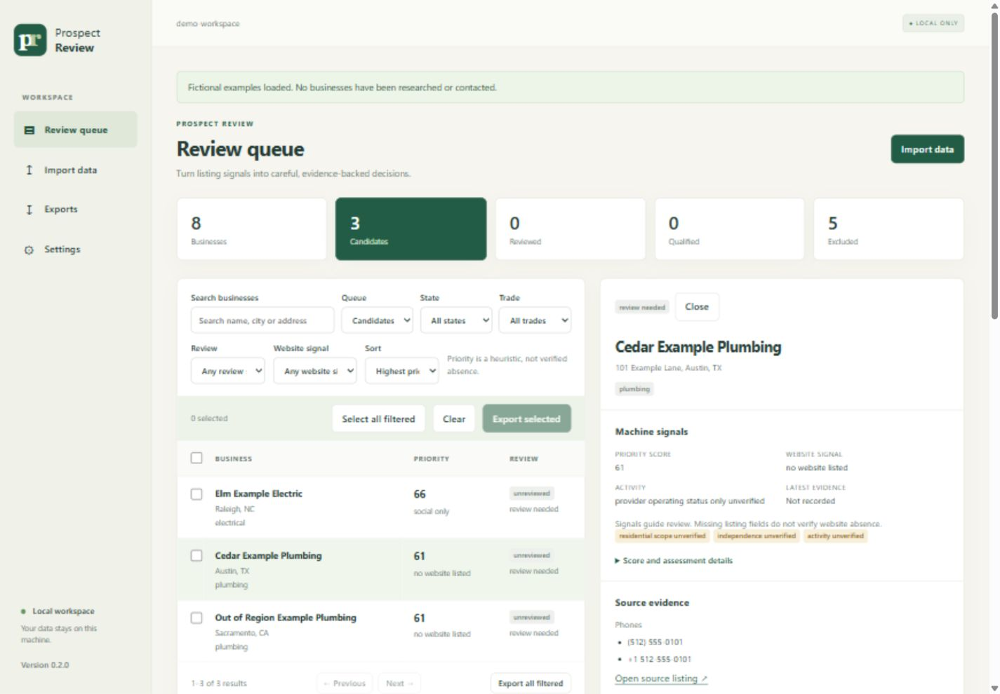

# Prospect Review

**A local app for reviewing business-listing files, with evidence you can follow.**

Prospect Review helps you inspect a local dataset you already have permission to use. It normalizes records, merges strong identity matches, distinguishes website signals, applies supplied exclusions and records human review decisions. Each score comes with reasons, and exports retain source provenance.

Built for modest US service-business datasets. Python **3.10+**, standard library only, **zero runtime dependencies**. No accounts, API keys, downloads or outreach are needed to run it.

## Open the local app

```sh
git clone https://github.com/andrem000/prospect-review.git
cd prospect-review
python -m prospect app
```

Use `python3` if that is your Python 3 command. Your browser opens the app; keep the terminal running and press **Ctrl+C** there to stop it. No installation is needed. Choose **Try fictional demo** for a safe first look, or import a file you have permission to use.

The app previews and maps CSV/JSON/JSONL files, records source permissions, and opens an Investigation desk with a searchable business queue, source evidence and explicit decisions. Guided review walks through identity, website, activity and service fit, then shows an editable summary before saving. Export selected or filtered records with their provenance in a ZIP. Reviews, unfinished drafts, settings and exports persist in `prospect-review-workspace/`. Launch from the same directory to resume, or use `--workspace /path/to/workspace` to choose another workspace.

The **Changes** inbox compares a reimport before confirmation, shows meaningful changes beside saved answers, and highlights old or undated evidence that needs attention. Marking an alert seen never replaces a decision or refreshes its evidence. Existing drafts survive reimports and warn when their source context changed.

The Investigation desk separates the effective saved answer and its evidence basis from your unfinished draft. It shows the latest imported observation for each source identity, with earlier observations in expandable history. Opening a Changes reason brings its before/after evidence into the relevant question; retained historical signals explain why an older website or contact detail can still affect screening.

The app runs on your machine, with no accounts, external interface assets or runtime dependencies. Optional research assistance checks one public website link you supply, only when you request it. It shows captured evidence and matching or conflicting business details; you decide whether to use a proposed answer in a draft. You can also analyze a saved page offline. No automatic review or outreach follows.

The server listens only on `127.0.0.1`; it is intended for a single local user. [The local app guide](docs/LOCAL-APP.md) covers the complete workflow, research limits and backups. The existing CLI remains available.



*Fictional demo records; no real businesses were researched or contacted.*

## Run the reproducible CLI demo

```sh
git clone https://github.com/andrem000/prospect-review.git
cd prospect-review
python demo.py --out demo-output
```

Use `python3` if that is your Python 3 command. No installation is required. The output directory must be new; repeat with a different `--out` path.

Expected result: **12 checks pass**. Ten fictional rows become eight US business identities, two review candidates and one qualified candidate after a **simulated** human review. Nothing is fetched or sent. The demo uses a fixed clock; no real business is checked, qualified or contacted.

Inspect these files in `demo-output/`:

| File | What it shows |
| --- | --- |
| `report.json` | Twelve assertions, input hashes and import/search metrics |
| `candidates.csv` / `candidates.json` | The review queue with scores and explanations |
| `audit-before-review.json` | Excluded examples and their reasons |
| `*.provenance.json` | Source rights and attribution accompanying each export |
| `demo.sqlite3` | Observations, reviews and durable exclusions |

Keep exports with their provenance sidecars. Synthetic fixtures are included; acquired business datasets are not.

## Optional installation

From the checkout, create a virtual environment and install locally:

```sh
python -m venv .venv
```

Activate it with `source .venv/bin/activate` on macOS/Linux or `.venv\Scripts\Activate.ps1` in Windows PowerShell, then run:

```sh
python -m pip install .
prospect-review demo --out installed-demo-output
prospect-review app
```

Installation may fetch build tooling. The installed demo bundles its fixtures and runs outside the checkout. The distribution is `prospect-review`; the Python module is `prospect`. `prospect` is also a command alias. This project is installed from source; the commands above do not assume a PyPI release.

## Review your own file

Create `local-data/`, put your input there and complete a copy of [`rights.template.json`](rights.template.json) with the applicable permissions and notices. Adapt [`config.example.json`](config.example.json); its regions are examples.

```sh
python -m prospect --db local-data/review.sqlite3 init
python -m prospect --db local-data/review.sqlite3 import local-data/input.csv --rights local-data/rights.json
python -m prospect --db local-data/review.sqlite3 search --config config.example.json
python -m prospect --db local-data/review.sqlite3 show 1
python -m prospect --db local-data/review.sqlite3 export --config config.example.json --out local-data/queue.json
```

Place global `--db` before the command. Load any existing exclusion file with `suppress` before using the queue. **Export refuses an existing output file or provenance sidecar**; choose new paths for each export. The [input and command reference](docs/REFERENCE.md) covers fields, suppression, manual review, profiles and reconciliation.

## Record and correct a review

Try this complete workflow with the **fictional** fixtures from the checkout. Use a new `review-example/` directory. The dates and evidence below are invented for the example; for your own data, supply the date you actually observed the evidence.

```sh
mkdir review-example
python -m prospect --db review-example/review.sqlite3 import fixtures/businesses.csv --rights fixtures/rights.synthetic.json
python -m prospect --db review-example/review.sqlite3 suppress fixtures/suppression.csv
python -m prospect --db review-example/review.sqlite3 review 1 --website-status no_site_found --activity active --ownership independent --residential yes --evidence-observed-at 2026-10-15 --evidence-url https://example.com/fictional-check --notes "SIMULATED: fictional website, activity and scope check; no real business reviewed."
python -m prospect --db review-example/review.sqlite3 show 1
```

ID `1` is Cedar Example Plumbing in this fresh fixture database. For your own data, inspect `search` and `show` to select the correct ID. The review response includes the saved effective fields. Qualification depends on the configured date and freshness window; this fixed-date example is not a permanently current review.

Now record a later, still fictional website correction:

```sh
python -m prospect --db review-example/review.sqlite3 review 1 --website-status uncertain --candidate-website https://possible.example.com --evidence-observed-at 2026-10-16 --evidence-url https://example.com/fictional-correction --notes "SIMULATED: possible website needs checking; no new activity check."
python -m prospect --db review-example/review.sqlite3 show 1
python -m prospect --db review-example/review.sqlite3 export --config config.example.json --out review-example/queue.json
```

The correction preserves independent ownership and residential fit. The review history contains both entries. The latest evidence date is 16 October, but the carried activity check remains dated 15 October. To record a new activity check, explicitly supply `--activity` with its evidence date, URL and notes. To clear a decision, explicitly supply `unknown` or `pending` as appropriate; `--replace` starts the decision from defaults. History, prior confirmed-site evidence and durable contact exclusions remain preserved. See [manual review semantics](docs/REFERENCE.md#manual-review) before updating real records.

## Interpret the results

- A missing website field is a listing signal, never proof that no website exists. Scores rank review priority, not purchase likelihood.
- `qualified` reflects recorded evidence and configured rules. It does not grant contact permission or verify present-day facts.
- `freshness_days` limits the age of manual activity evidence. Entering or correcting a review does not refresh an old activity observation; undated legacy activity evidence remains unverified.
- Reimport preserves business identities but appends batches and observations. It is not a byte-identical database operation.
- Rules cover finite host/category patterns; uncertain cases need human review. Provider-hosted sites require evidence-backed confirmation.
- The working dataset is loaded into memory. National-scale performance, classification precision and commercial outcomes are not established.

Saved Overture and OSM/Overpass adapters are included; acquisition and source-rights decisions remain yours. See [design and limitations](docs/DESIGN.md) and [software/data rights](docs/RIGHTS.md).

## Contribute and license

Run `python -m unittest discover -s tests -v`. [Contribution guidance](CONTRIBUTING.md) describes reproducible reports and synthetic tests. See the [changelog](CHANGELOG.md) for version history.

Original code, documentation and synthetic fixtures are available under the [MIT License](LICENSE), copyright 2026 André Matos. Imported data retains its own rights and obligations.
